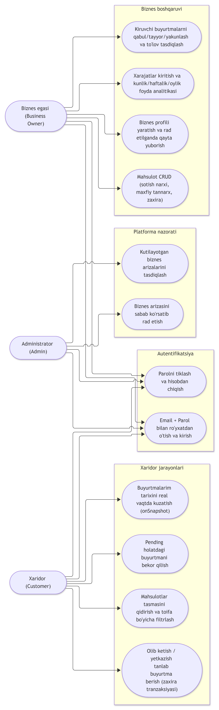

# 04. Talablar muhandisligi va Use Case modeli

**Loyiha nomi:** Dasturxon (Mahalla Bozori)  
**Fan:** Dasturiy injiniringga kirish  

---

## 1. Intervyu savol-javob shabloni (talaba haqiqiy suhbat asosida to‘ldiradi)

Quyidagi intervyu savollari mahalladagi novvoyxona/ovqat biznesi egasi hamda xaridor bilan jonli suhbat o‘tkazish uchun tayyorlangan. Javob kataklari ataylab to‘ldirilmagan.

### A) Mahalliy biznes egasi bilan intervyu
- **Respondent (yoshi / faoliyat turi):** `[TO'LDIRING]`
- **Sana:** `[TO'LDIRING]`

1. *Hozir mijozlar sizdan oldindan buyurtmani qanday usulda qiladi va bu sizga qanday noqulaylik tug‘diradi?*  
   **Javob:** `[TO'LDIRING]`
2. *Kun davomida qancha non yoki mahsulot qolganini va oxirida qancha sof foyda qolganini qanday hisoblaysiz?*  
   **Javob:** `[TO'LDIRING]`
3. *Agar telefon yoki kompyuterda buyurtmalar soni, zaxira va kunlik foyda bitta oynada ko‘rinsa, siz uchun eng muhim ikkita qulaylik nima bo‘lar edi?*  
   **Javob:** `[TO'LDIRING]`
4. *Boshqa sotuvchilar yoki xaridorlar sizning mahsulotingiz tannarxini ko‘rmasligi siz uchun qanchalik muhim?*  
   **Javob:** `[TO'LDIRING]`

### B) Mahalla xaridori bilan intervyu
- **Respondent:** `[TO'LDIRING]`
- **Sana:** `[TO'LDIRING]`

1. *Yaqin atrofdan issiq non yoki tayyor taom olishda qanday holatlarda vaqt yo‘qotasiz (masalan, tugab qolishi, navbat)?*  
   **Javob:** `[TO'LDIRING]`
2. *Buyurtma holatini (tayyorlanmoqda / olib ketishga tayyor) telefon ekranidan real vaqtda ko‘rish sizga nima beradi?*  
   **Javob:** `[TO'LDIRING]`
3. *Ilovaga kirgandan buyurtma berguncha nechta qadam va qanday ma’lumot bo‘lishini xohlaysiz?*  
   **Javob:** `[TO'LDIRING]`

---

## 2. Funksional talablar (FR — 12 ta)

Barcha funksional talablar loyihaning haqiqiy veb-modullari (`web/src/`) bilan bog‘langan:

| ID | Funksional talab tavsifi | Rol | Asosiy modul / fayl |
| :--- | :--- | :--- | :--- |
| **FR-01** | Foydalanuvchi Email, parol, to‘liq ism, taxallus (`nickname`) va telefon raqami bilan `customer` yoki `owner` rolida ro‘yxatdan o‘ta olishi shart. | Mehmon | `pages/RegisterPage.tsx`, `repositories/authRepository.ts` |
| **FR-02** | Kirish oynasida parolni ko‘rsatish/yashirish tugmasi, parolni tiklash va tushunarli o‘zbekcha xato xabarlari bo‘lishi shart. | Barcha | `pages/LoginPage.tsx`, `services/errors.ts` |
| **FR-03** | Tizim har bir sahifaga kirishdan oldin foydalanuvchi rolini (`RoleGuard`) tekshirishi va ruxsatsiz foydalanuvchini o‘z rol sahifasiga yo‘naltirishi shart. | Barcha | `components/RouteGuards.tsx`, `services/routing.ts` |
| **FR-04** | Xaridor tasmasida faqat `approved` holatdagi bizneslarning chop etilgan (`published = true`) mahsulotlari nom bo‘yicha qidiruv va toifa filtri (`Nonvoyxona`, `Qandolatxona`, va h.k.) bilan ko‘rinishi shart. | `customer` | `pages/customer/CustomerFeedPage.tsx`, `hooks/useCustomerFeed.ts` |
| **FR-05** | Xaridor buyurtma berishda miqdorni (1–99), olish usulini (`pickup` yoki `delivery`) va yetkazish manzili / olib ketish vaqtini tanlay olishi shart. | `customer` | `components/customer/OrderCheckoutModal.tsx` |
| **FR-06** | Buyurtma yaratilishida mahsulot zaxirasi Cloud Firestore tranzaksiyasi (`runTransaction`) ichida atomik kamaytirilishi va zaxira yetarli bo‘lmasa buyurtma rad etilishi shart. | Tizim | `repositories/orderRepository.ts`, `services/orderLogic.ts` |
| **FR-07** | Xaridor *"Buyurtmalarim"* sahifasida barcha buyurtmalari holatini (`pending`, `accepted`, `ready`, `completed`, `rejected`, `cancelled`) real vaqtda (`onSnapshot`) ko‘rishi va faqat `pending` holatda bekor qila olishi shart. | `customer` | `pages/customer/CustomerOrdersPage.tsx`, `hooks/useCustomerOrders.ts` |
| **FR-08** | Biznes egasi o‘z biznes profilini yaratishi (`pending`), admin rad etsa rad etish sababini (`rejectionReason`) ko‘rib profilni tahrirlab qayta yuborishi (`pending`) shart. | `owner` | `pages/owner/OwnerBusinessGate.tsx`, `components/owner/BusinessEditModal.tsx` |
| **FR-09** | Tasdiqlangan biznes egasi mahsulot qo‘shishi, tahrirlashi, o‘chirishi hamda zaxira va sotish narxini boshqarishi; mahsulot tannarxi (`costPrice`) esa `products/{id}/private/cost` hujjatida alohida saqlanishi shart. | `owner` | `pages/owner/OwnerProductsPage.tsx`, `repositories/productRepository.ts` |
| **FR-10** | Biznes egasi kiruvchi buyurtmalar holatini (`accepted -> ready -> completed`) ketma-ket o‘tkazishi va to‘lovni tasdiqlashi (`paymentStatus = paid`) shart. | `owner` | `pages/owner/OwnerOrdersPage.tsx`, `hooks/ownerActions.ts` |
| **FR-11** | Biznes egasi kunlik xarajatlarni kiritishi hamda *"Bugun"*, *"Bu hafta"*, *"Bu oy"*, *"Barchasi"* davrlari bo‘yicha daromad (`completed + paid`), yalpi va sof foyda analitikasini ko‘rishi shart. | `owner` | `pages/owner/OwnerAnalyticsPage.tsx`, `services/analytics.ts` |
| **FR-12** | Administrator kutilayotgan va barcha bizneslarni ko‘rishi, ularni tasdiqlashi (`approved`) yoki majburiy sabab ko‘rsatib rad etishi (`rejected`) shart. | `admin` | `pages/admin/AdminDashboardPage.tsx`, `components/admin/RejectBusinessModal.tsx` |

---

## 3. Nofunksional talablar (NFR — 8 ta)

| ID | Sifat toifasi | Nofunksional talab tavsifi | O‘lchov / cheklov |
| :--- | :--- | :--- | :--- |
| **NFR-01** | **Xavfsizlik (Ma’lumot izolyatsiyasi)** | Foydalanuvchi o‘z `role` maydonini o‘zgartira olmasligi, xaridor boshqa xaridorning buyurtmasini o‘qiy olmasligi va `costPrice` ga faqat biznes egasi hamda admin kira olishi shart. | `firestore.rules` (39 ta emulyator qoida testi 100% o‘tishi kerak). |
| **NFR-02** | **Xavfsizlik (Kirish ma’lumotlari va XSS)** | Barcha kiritiladigan matnlar nazorat belgilaridan va HTML teglaridan (`sanitizeUserText`) tozalanishi, React JSX da `dangerouslySetInnerHTML` ishlatilmasligi va CSP sarlavhalari yoqilgan bo‘lishi shart. | ESLint, `validators.ts`, `firebase.json` CSP. |
| **NFR-03** | **Ishonchlilik va yaxlitlik** | Bir vaqtda ikki xaridor oxirgi mahsulotni sotib olmoqchi bo‘lsa, zaxira manfiy songa tushmasligi (`stock >= 0`) va tranzaksiya qoidalar orqali ham (`getAfter()`) tasdiqlanishi shart. | `runTransaction` + `firestore.rules` + Vitest chegara testlari. |
| **NFR-04** | **Foydalanish qulayligi va mobil moslashuvchanlik** | Ilova `390x844` telefon ekranida gorizontal aylanish (`overflow-x`) siz ishlashi va asosiy harakatlar o‘zbek tilida tushunarli bo‘lishi shart. | Chrome DevTools tekshiruvi: `scrollWidth == innerWidth`. |
| **NFR-05** | **Tezkorlik (Ishlash unumdorligi)** | Mahsulot yig‘masi Vite da siqilgan holda tez yuklanishi va `vite preview` muhitida FCP hamda DOM yuklanishi barqaror bo‘lishi shart. | Gzip JS to‘plami <= 350 kB; FCP < 3 soniya lokal/ishlab chiqarish muhitida. |
| **NFR-06** | **Qo‘llab-quvvatlanuvchanlik** | Kod uch qatlamli arxitekturaga bo‘linishi (`pages/components -> hooks/services -> repositories`) va UI fayllarida to‘g‘ridan-to‘g‘ri `firebase/*` importi taqiqlanishi shart. | ESLint (`no-restricted-imports`), Prettier, `CODE_CONVENTIONS.md`. |
| **NFR-07** | **Maxfiylik (Saqlash)** | Autentifikatsiya tokenlari va shaxsiy sessiya ma’lumotlari `localStorage` yoki konsol loglariga chiqarilmasligi, `indexedDBLocalPersistence` dan foydalanilishi shart. | `window.localStorage.length === 0`. |
| **NFR-08** | **Tarqatish qulayligi** | Veb-ilova alohida o‘rnatishsiz zamonaviy brauzerlarda (Chrome, Safari, Edge) URL orqali ishlashi shart. | Firebase Hosting statik SPA tarqatish tayyorgarligi. |

---

## 4. Use Case (Foydalanish holatlari) diagrammasi

Quyidagi Use Case diagrammasi uchta asosiy aktor (`Xaridor`, `Biznes egasi`, `Administrator`) va ular bajaradigan 12 ta asosiy foydalanish holatini aks ettiradi (manba fayl: [use-case.mmd](file:///C:/Users/asadb/AndroidStudioProjects/Dasturxon/docs/diagrams/use-case.mmd)).

*1-rasm. Dasturxon platformasining Use Case (foydalanish holatlari) diagrammasi.*
