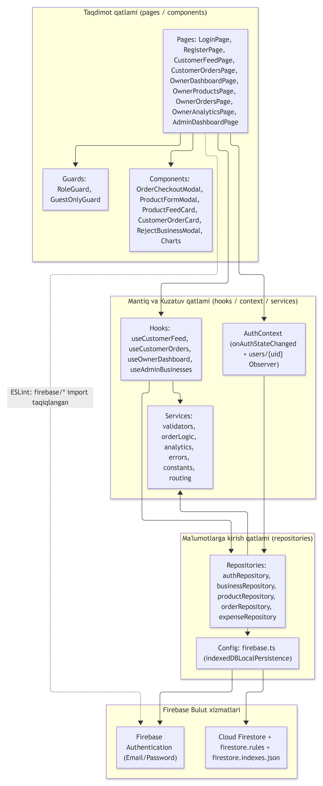
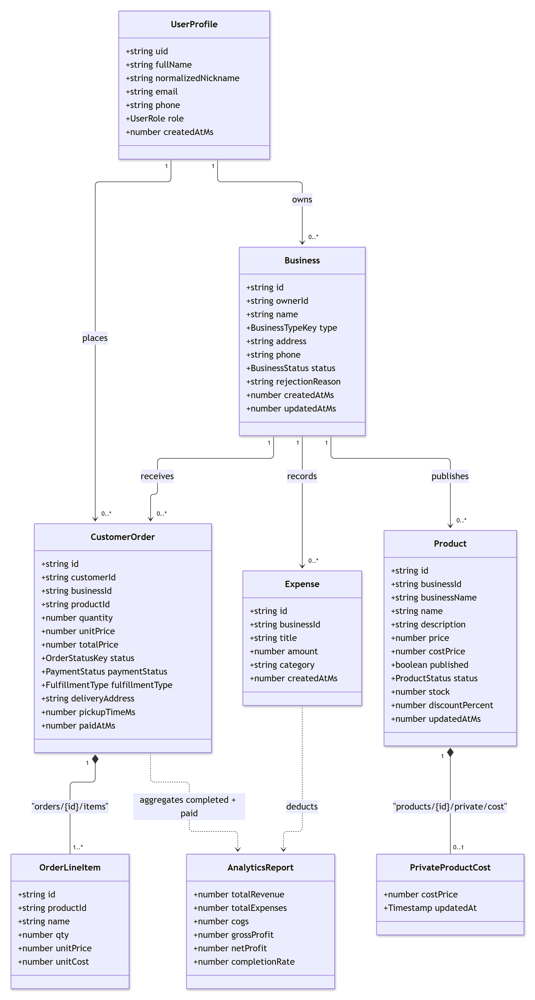
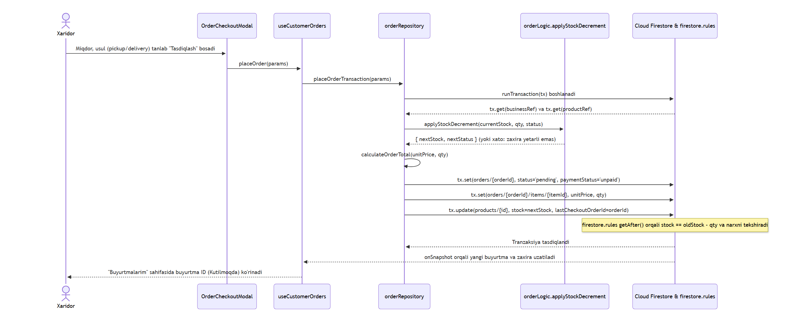

# 05. Tizimni loyihalash (Arxitektura, Sinf va Ketma-ketlik diagrammalari)

**Loyiha nomi:** Dasturxon (Mahalla Bozori)  
**Fan:** Dasturiy injiniringga kirish  

---

## 1. Talablardan chiqarilgan asosiy abstraksiyalar

04-bosqich talablar tahlili asosida tizimning domen modeli va kod tuzilmasi quyidagi asosiy abstraksiyalarga ajratildi:

1. **Foydalanuvchi (`UserProfile`):** Rolga bog‘langan shaxs (`customer`, `owner`, `admin`); `users/{uid}` hujjatida saqlanadi, taxallus noyobligi esa `usernames/{normalizedNickname}` orqali ta’minlanadi.
2. **Mahalliy biznes (`Business`):** Biznes egasiga biriktirilgan savdo nuqtasi (`bakery`, `confectionery`, `pastry`, `teahouse`, `kitchen`, `cafe`, `other`), tasdiqlash hayot sikli (`pending -> approved | rejected | suspended`) ga ega.
3. **Mahsulot (`Product`) va Maxfiy tannarx (`PrivateProductCost`):** Ommaviy ko‘rinadigan narx, chegirma va zaxira `products/{id}` da; faqat egasi va admin ko‘ra oladigan tannarx (`costPrice`) esa alohida `products/{id}/private/cost` hujjatida izolyatsiya qilinadi.
4. **Buyurtma (`CustomerOrder`) va Buyurtma qatori (`OrderLineItem`):** Xaridor va biznes o‘rtasidagi atomik savdo yozuvi (`pending -> accepted -> ready -> completed | rejected | cancelled`), to‘lov holati (`unpaid | paid`) hamda yetkazish turi (`pickup | delivery`) ni o‘z ichiga oladi.
5. **Xarajat (`Expense`) va Moliyaviy hisobot (`AnalyticsReport`):** Biznes xarajatlari (`Xomashyo`, `Kommunal`, `Ish haqi`, `Boshqa`) va faqat `completed + paid` buyurtmalardan hisoblanadigan tushum, COGS, yalpi foyda hamda sof foyda hisoboti.

---

## 2. Qatlamli arxitektura diagrammasi

Android versiyasidagi UI va Firestore aralashtirilgan monolit xatosini takrorlamaslik uchun `web/src/` uchta qat’iy ajratilgan qatlamga qurildi (manba fayl: [architecture-layers.mmd](file:///C:/Users/asadb/AndroidStudioProjects/Dasturxon/docs/diagrams/architecture-layers.mmd)).

*2-rasm. Dasturxon veb-ilovasining qatlamli arxitekturasi (`pages/components -> hooks/context/services -> repositories`).*

**Qatlamlar o‘rtasidagi chegara qoidasi:** ESLint ning `no-restricted-imports` qoidasi `pages/` va `components/` fayllarida `firebase/*` paketlarini import qilishni avtomatik taqiqlaydi. Barcha Firebase murojaatlari faqat `src/repositories/` ichida joylashadi.

---

## 3. Sinf diagrammasi (Domain Class Diagram)

Quyidagi sinf diagrammasi `web/src/types/domain.ts` va hisoblash xizmatlarida amalda mavjud bo‘lgan haqiqiy TypeScript interfeyslari hamda ularning Cloud Firestore dagi bog‘lanishlarini ko‘rsatadi (manba fayl: [class-diagram.mmd](file:///C:/Users/asadb/AndroidStudioProjects/Dasturxon/docs/diagrams/class-diagram.mmd)).

*3-rasm. Dasturxon asosiy domen sinflari va ular o‘rtasidagi bog‘lanishlar diagrammasi.*

---

## 4. Ketma-ketlik diagrammasi (Buyurtma berish va zaxira tranzaksiyasi)

Eng muhim va xatoga eng sezgir jarayon — xaridor buyurtma berayotganda mahsulot zaxirasini kamaytirishdir. Ikki xaridor bir soniyada oxirgi 1 ta nonni sotib olmoqchi bo‘lganda zaxira `-1` bo‘lib ketmasligi uchun `orderRepository.ts` da `runTransaction` qo‘llanilgan (manba fayl: [order-sequence.mmd](file:///C:/Users/asadb/AndroidStudioProjects/Dasturxon/docs/diagrams/order-sequence.mmd)).

*4-rasm. Buyurtma berish jarayonining `runTransaction` va `firestore.rules` bilan ketma-ketlik diagrammasi.*

---

## 5. Qo‘llanilgan dizayn shablonlari (Design Patterns) va sabablari

| Shablon (Pattern) | Amaliyotdagi fayllar | Nima uchun tanlangan? |
| :--- | :--- | :--- |
| **Repository Pattern** | `authRepository.ts`, `businessRepository.ts`, `productRepository.ts`, `orderRepository.ts`, `expenseRepository.ts` | Firestore so‘rovlari, tranzaksiyalar va snapshotlarni domen obyektlariga aylantirishni UI komponentlardan to‘liq ajratish uchun. Keyinchalik backend almashsa ham UI kodiga tegilmaydi. |
| **Observer Pattern** | `context/AuthContext.tsx`, `hooks/useCustomerFeed.ts`, `hooks/useCustomerOrders.ts`, `hooks/useOwnerDashboard.ts`, `hooks/useAdminBusinesses.ts` | Firestore `onSnapshot` va `onAuthStateChanged` tinglovchilarini React hooklari orqali o‘rash uchun. Biznes tasdiqlanganda, mahsulot zaxirasi tugaganda yoki buyurtma tayyor bo‘lganda sahifa qayta yuklanmasdan bir zumda yangilanadi. |
| **Pure Domain Service** | `services/orderLogic.ts`, `services/analytics.ts`, `services/validators.ts` | Zaxira kamaytirish (`applyStockDecrement`), summa (`calculateOrderTotal`), foyda (`buildAnalyticsReport`) va validatsiya qoidalarini sof TypeScript funksiyalarga chiqarish uchun. Bu Vitest da Firebase emulyatorisiz millisekundlarda 100% deterministik testlash imkonini berdi. |
| **Route Guard Pattern** | `components/RouteGuards.tsx` (`RoleGuard`, `GuestOnlyGuard`) | Foydalanuvchi holati va roliga qarab marshrutlarni deklarativ himoya qilish hamda noto‘g‘ri rol bilan kirishga urinilganda o‘z paneliga yo‘naltirish uchun. |
