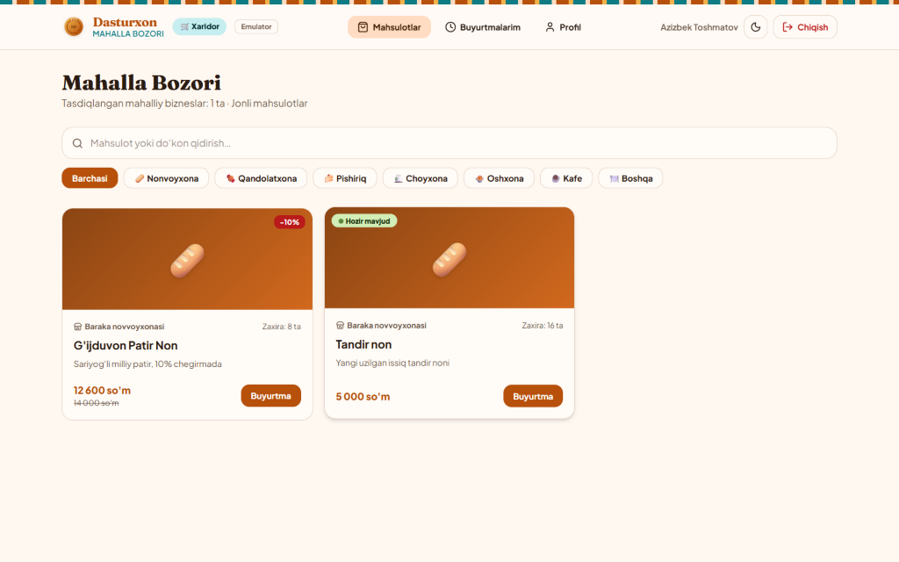
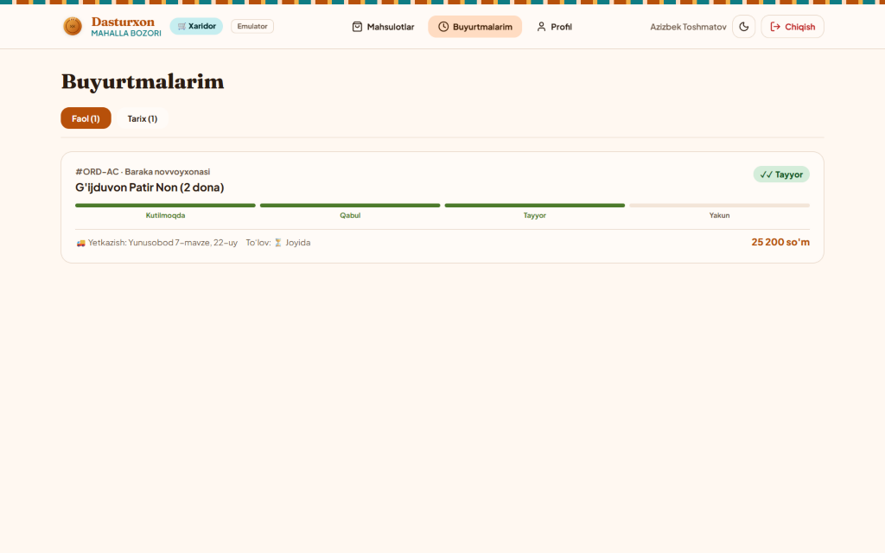
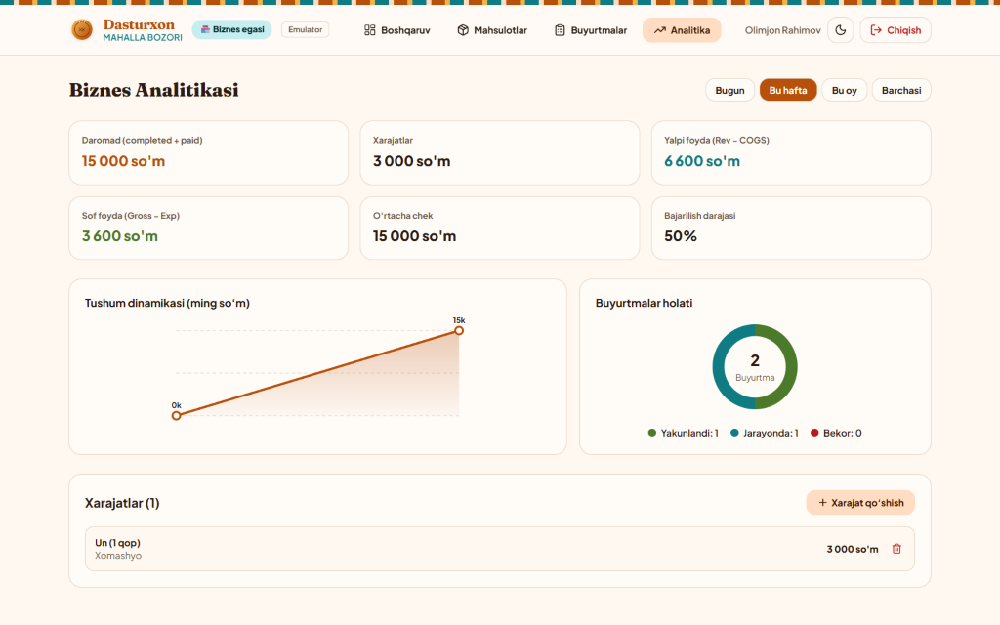
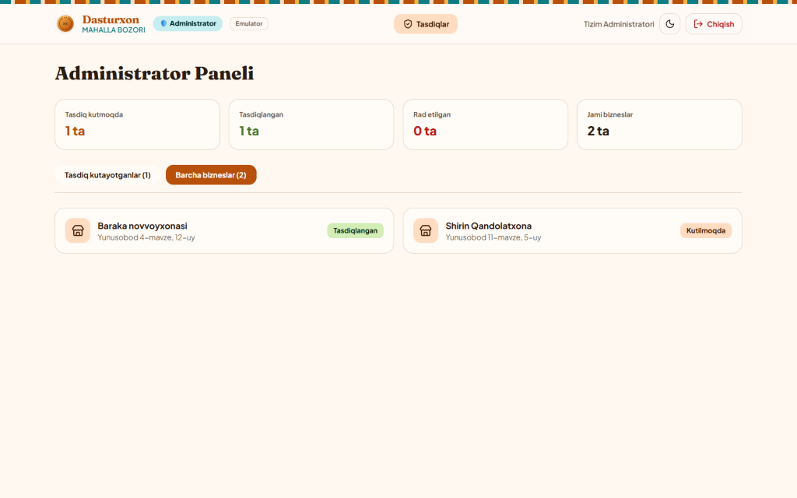

# 06. Foydalanuvchi interfeysi (UX) va foydalanish qulayligi sinovi

**Loyiha nomi:** Dasturxon (Mahalla Bozori)  
**Fan:** Dasturiy injiniringga kirish  

---

## 1. Asosiy ekranlar va ishlayotgan ilovadan olingan haqiqiy skrinshotlar

Barcha ekran tasvirlari ishlab turgan Dasturxon veb-ilovasidan (`http://127.0.0.1:5173`, Firebase Auth va Firestore Emulyatoriga ulangan holda) `1280x800` o‘lchamli brauzer oynasida olindi.

### 1.1. Xaridor vitrinasi (Mahsulotlar tasmasini qidirish va filtrlash)

Xaridor (`customer@dasturxon.test` — *Azizbek Toshmatov*) tizimga kirganidan so‘ng faqat tasdiqlangan bizneslarning chop etilgan mahsulotlarini ko‘radi. Sahifada nom/do‘kon bo‘yicha qidiruv maydoni, 7 ta toifa filtri (*Nonvoyxona*, *Qandolatxona*, *Pishiriq*, *Choyxona*, *Oshxona*, *Kafe*, *Boshqa*), chegirma belgilari (`-10%`) hamda jonli zaxira soni (`Zaxira: 8 ta`, `Zaxira: 16 ta`) aks etadi.

*5-rasm. Xaridor roli — "Mahalla Bozori" mahsulotlar tasmasida qidiruv, toifalar va chegirmali kartochkalar.*

### 1.2. Xaridorning "Buyurtmalarim" sahifasi (Real vaqtda kuzatish)

Xaridor buyurtma berganidan keyin barcha buyurtmalar *Faol* va *Tarix* bo‘limlariga ajraladi. Har bir kartochkada biznes nomi, buyurtma tarkibi, to‘rt bosqichli jarayon indikatori (`Kutilmoqda -> Qabul -> Tayyor -> Yakun`), yetkazish/olib ketish ma’lumoti hamda umumiy summa ko‘rsatiladi (`onSnapshot` orqali qayta yuklashsiz yangilanadi).

*6-rasm. Xaridor roli — "Buyurtmalarim" sahifasida faol buyurtma va 4 bosqichli holat indikatori.*

### 1.3. Biznes egasi analitikasi va xarajatlar nazorati

Biznes egasi (`owner@dasturxon.test` — *Olimjon Rahimov*) o‘z do‘konining moliyaviy ko‘rsatkichlarini davrlar (*Bugun*, *Bu hafta*, *Bu oy*, *Barchasi*) kesimida kuzatadi. Daromad faqat yakunlangan va to‘langan (`completed + paid`) buyurtmalardan hisoblanadi; tannarx (`COGS`) va kiritilgan xarajatlar ayrilib, yalpi hamda sof foyda grafigi chiqariladi.

*7-rasm. Biznes egasi roli — "Biznes Analitikasi" KPI kartochkalari, tushum dinamikasi va xarajatlar ro‘yxati.*

### 1.4. Administrator tasdiqlash paneli

Platforma administratori (`admin@dasturxon.test`) barcha ro‘yxatdan o‘tgan bizneslarni ko‘radi, kutilayotgan arizalarni (`Shirin Qandolatxona` — *Kutilmoqda*) filtrlaydi va tekshiruvdan so‘ng tasdiqlaydi yoki majburiy sabab ko‘rsatib rad etadi.

*8-rasm. Administrator roli — tasdiq kutayotgan va tasdiqlangan bizneslar boshqaruv paneli.*

---

## 2. Taxminiy UX (foydalanish qulayligi) muammolari va yechimlar

| № | Taxmin qilingan UX muammosi | Ta’sir etiladigan rol | Ko‘rilgan amaliy chora |
| :--- | :--- | :--- | :--- |
| **1** | **Kichik telefon ekranida (`390px`) yuqori panel sig‘masligi:** brend nishoni va tugmalar yonma-yon chiqib gorizontal aylanish (`overflow-x`) hosil qilishi mumkin. | Barcha | `WelcomePage.tsx` va `DxLogo.tsx` qayta sozlandi (`b836501` commit); Chrome DevTools da `scrollWidth === 390 === innerWidth` tasdiqlandi. |
| **2** | **Kutilayotgan biznes egasi nima qilishni bilmasligi:** ariza `pending` yoki `rejected` paytida mahsulot qo‘shib bo‘lmaganda foydalanuvchi adashishi mumkin. | `owner` | `OwnerBusinessGate.tsx` sahifasi biznes holatini (`Kutilmoqda` / `Rad etildi`) aniq tushuntiradi va rad etish sababini (`rejectionReason`) hamda qayta yuborish tugmasini darhol ko‘rsatadi. |
| **3** | **Yetkazish manzilini unutib qoldirish:** `delivery` tanlanganda manzil bo‘sh qolsa tushunarsiz tizim xatosi chiqishi xavfi. | `customer` | `OrderCheckoutModal.tsx` va `validators.ts` da maydon darhol tekshirilib, aniq o‘zbekcha yo‘riqnoma xabari ko‘rsatiladi. |
| **4** | **Buyurtma berishdagi bosqichlar soni:** xaridor non sotib olish uchun ko‘p sahifalardan o‘tsa charchaydi. | `customer` | Vitrina kartochkasidan tugma bosilganda modal oynaning o‘zida 3 harakatda (miqdor -> olish usuli -> Tasdiqlash) buyurtma yakunlanadi. |

---

## 3. Foydalanish qulayligini sinash shabloni (talaba haqiqiy odamlar bilan to‘ldiradi)

> **Muhim:** Quyidagi jadvaldagi natijalar bo‘sh shablon sifatida berilgan. Talaba kamida 3 nafar real sinov ishtirokchisiga vazifalarni bajartirib, haqiqiy soniya, xato soni va fikrlarni kiritishi shart.

### Sinov vazifalari ro‘yxati
1. **T1 (Xaridor):** Tizimga kirish, *Nonvoyxona* toifasini tanlash va 2 dona non uchun `pickup` buyurtma berish.
2. **T2 (Xaridor):** *"Buyurtmalarim"* sahifasidan aktiv buyurtma holatini topish va `pending` buyurtmani bekor qilish.
3. **T3 (Biznes egasi):** Yangi xarajat (*Xomashyo*) qo‘shish va *"Bu hafta"* sof foydasini topish.
4. **T4 (Administrator):** Kutilayotgan biznes arizasini topib, tasdiqlash yoki sabab bilan rad etish.

### Haqiqiy sinov natijalari jadvali (`[TO'LDIRING]`)

| Ishtirokchi | T1 vaqti (sek) | T1 xato soni | T2 bajarildimi? | T3/T4 qulaylik bahosi (1–5) | Asosiy og‘zaki fikr / qiynalgan joyi |
| :--- | :---: | :---: | :---: | :---: | :--- |
| **Ishtirokchi 1** (`[TO'LDIRING]`) | `[TO'LDIRING]` | `[TO'LDIRING]` | `[TO'LDIRING]` | `[TO'LDIRING]` | `[TO'LDIRING]` |
| **Ishtirokchi 2** (`[TO'LDIRING]`) | `[TO'LDIRING]` | `[TO'LDIRING]` | `[TO'LDIRING]` | `[TO'LDIRING]` | `[TO'LDIRING]` |
| **Ishtirokchi 3** (`[TO'LDIRING]`) | `[TO'LDIRING]` | `[TO'LDIRING]` | `[TO'LDIRING]` | `[TO'LDIRING]` | `[TO'LDIRING]` |

---

## 4. UX sinovi bo‘yicha yakuniy xulosalar (talaba to‘ldiradi)

- **Eng tushunarli bo‘lgan ekran va sababi:** `[TO'LDIRING]`
- **Sinovchilar qiynalgan joyi / tushunmagan atamalar:** `[TO'LDIRING]`
- **Keyingi iteratsiyada qilinishi kerak bo‘lgan UX yaxshilanishlar:** `[TO'LDIRING]`
